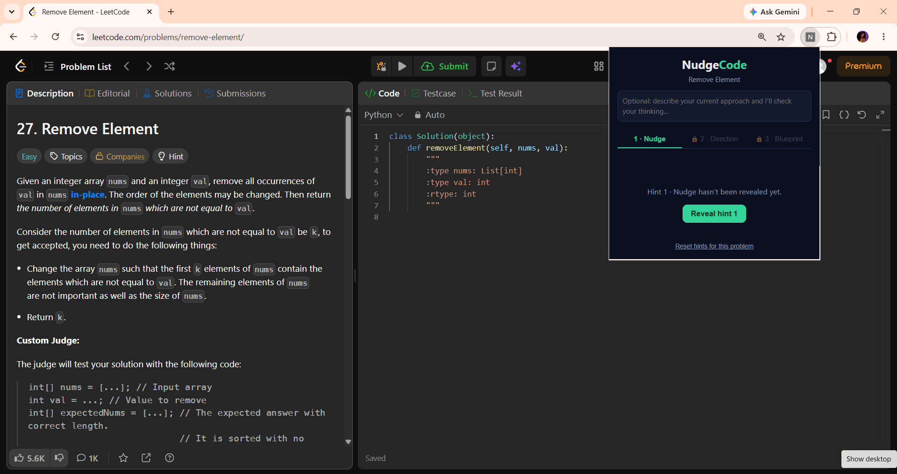
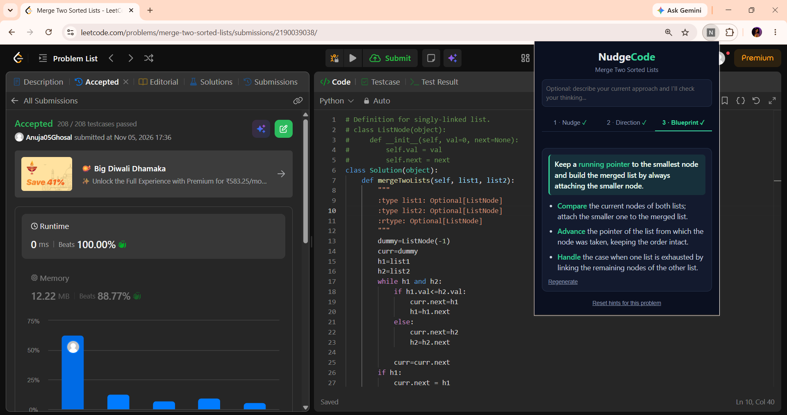

# NudgeCode

> Spoiler-free, step-by-step AI hints for LeetCode. Think for yourself, with a little guidance.

NudgeCode is a Chrome extension that reads your open LeetCode problem and provides three levels of AI-powered hints — from a gentle nudge to a plain-English solution plan. It guides your thinking without giving away code or the full solution.

## Preview





## Features

- **3-level hint system:** Nudge, Direction, and Blueprint, unlocked progressively.
- **Tabbed interface:** Focus on one hint at a time.
- **Key idea highlights:** Important concepts are highlighted in bold.
- **Approach feedback:** Describe your approach and get guidance without spoilers.
- **Persistent hints:** Hints are saved separately for each problem.
- **Spoiler-safe AI:** Prompts prevent code, algorithm names, and complexity disclosures.

## Tech Stack

- **Extension:** Chrome Manifest V3, JavaScript, HTML, CSS
- **Backend:** Node.js, Express, groq-sdk
- **AI:** Groq API

## Project Structure

```text
NudgeCode/
├── backend/
│   ├── index.js
│   ├── listModels.js
│   ├── package.json
│   └── .env
├── extension/
│   ├── manifest.json
│   ├── popup.html
│   ├── popup.css
│   └── popup.js
├── screenshots/
└── README.md
```

## Getting Started

**Prerequisites:** Node.js 18+, Google Chrome, and a free [Groq API key](https://console.groq.com).

### 1. Clone the repository

```bash
git clone https://github.com/<your-username>/NudgeCode.git
cd NudgeCode
```

### 2. Set up the backend

```bash
cd backend
npm install
```

Create a `.env` file inside `backend/`:

```env
GROQ_API_KEY=your_key_here
```

Start the server:

```bash
node index.js
```

Keep the terminal running while using the extension.

### 3. Install the extension

1. Open `chrome://extensions`.
2. Enable **Developer mode**.
3. Click **Load unpacked** and select the `extension/` folder.
4. Pin NudgeCode from the Extensions menu.

Reload the extension from `chrome://extensions` whenever you modify its files.

### 4. Start using NudgeCode

1. Open a problem on [LeetCode](https://leetcode.com/problems/).
2. Click the NudgeCode extension icon.
3. Optionally describe your current approach.
4. Reveal Hint 1 and progress through the hint levels.

## License

**MIT License © 2026 NudgeCode Contributors**

NudgeCode is open-source software released under the MIT License.

You are free to use, modify, distribute, and build upon this project, subject to the terms of the license.

See the [LICENSE](LICENSE) file for the complete license terms.
